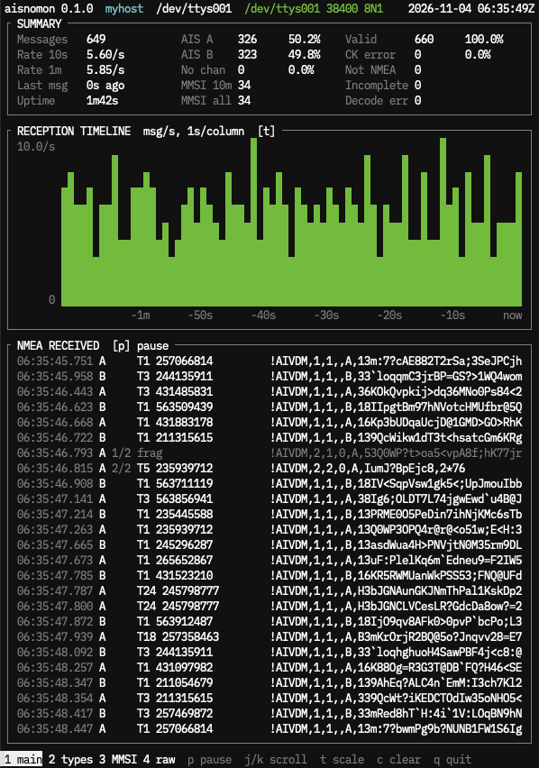
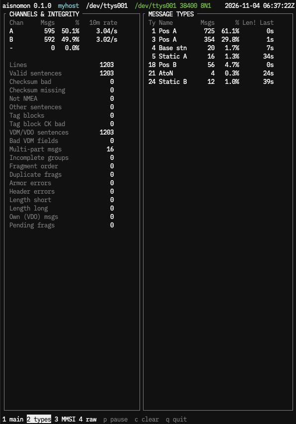
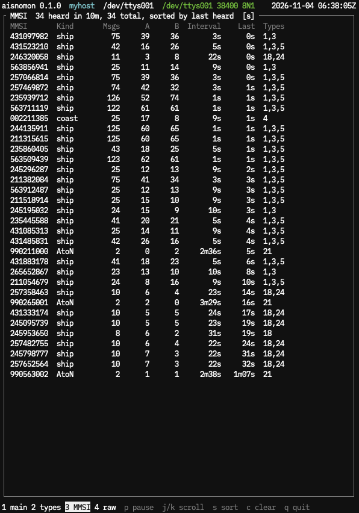
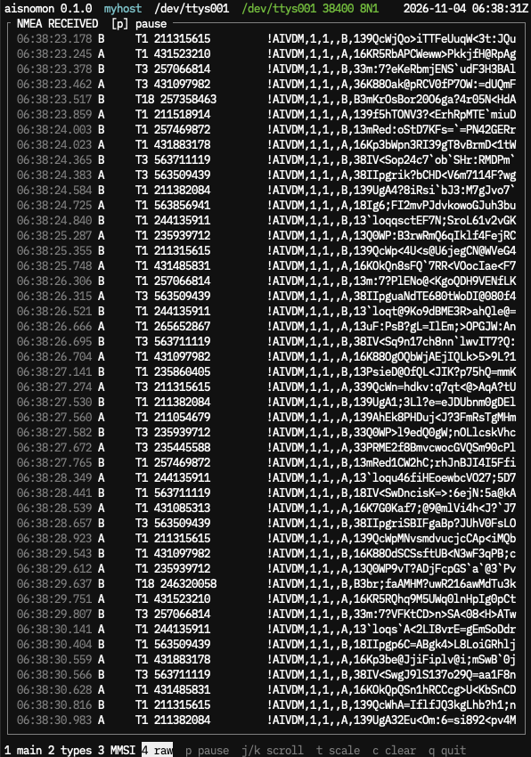

# aisnomon

A real-time AIS and NMEA 0183 reception monitor.

aisnomon is a diagnostic tool for monitoring AIS reception quality, NMEA data
integrity and message statistics. It is designed for AIS receiver operators
who want to understand and monitor their reception environment.

**A tool for observing the AIS reception environment, not for viewing vessels
on a map.** It does not decode positions and has no map. It answers:

- **Is the receiver hearing anything, and how much?** Messages per second,
  live and as a timeline at 1 s to 1 h per column, kept for 24 h.
- **Are both channels working?** Messages on AIS 1 (A, 161.975 MHz) and
  AIS 2 (B, 162.025 MHz), side by side.
- **Is the NMEA output clean?** Checksum errors, non-NMEA noise, malformed
  VDM fields, bad 6-bit armoring, wrong payload lengths.
- **Do multi-sentence messages arrive whole?** Lost, duplicate, out-of-order
  and timed-out fragments.
- **Who is heard, how often?** Unique MMSIs in a recent window and in total,
  with per-MMSI counts, channel split, mean interval and message types.

Part of the same family as gnomon (GNSS/NMEA monitor) and metronomon (PPS
monitor), both in the [gnomon](https://github.com/tanyorg/gnomon)
repository, and built on the same terminal and serial code. No external crates (std only). Read-only: it never
writes to a receiver.



## Install

From source (not on crates.io yet):

```sh
git clone https://github.com/tanyorg/aisnomon
cd aisnomon
cargo install --path .
```

Requires Rust 1.80 or later (built and tested with 1.80.1 and 1.99.1).
Tested on Linux and macOS (unit tests, and serial input through a pty; the
screenshots are from macOS). The termios, `TIOCGWINSZ` and `fcntl`
constants also cover FreeBSD, NetBSD, OpenBSD and DragonFly, but those
platforms have not been tested yet.

## Usage

```sh
aisnomon /dev/ttyUSB0                 # serial; probes 38400, 4800, 9600, ...
aisnomon -s 38400 /dev/cuaU0          # serial at a fixed speed
aisnomon 192.0.2.10:10110             # raw NMEA over TCP (client)
aisnomon udp://:10110                 # listen for UDP on 0.0.0.0:10110
aisnomon udp://[::]:10110             # listen on IPv6 (see the dual-stack note)
aisnomon udp://239.192.0.2:60002      # join an IPv4 multicast group
aisnomon -l ais.log 192.0.2.10:10110  # also append every line to ais.log
aisnomon -f ais.log                   # replay a capture
nc 192.0.2.10 10110 | aisnomon --snapshot 60 -f -   # one screen, no TUI
```

`--snapshot SECS` runs without a terminal and prints one screen, for cron,
scripts or sharing; `--view 1-4` picks which screen and `--size WxH` the
canvas. `-w SECS` sets the "recently heard" MMSI window (default 600) and
`-a` draws boxes in ASCII for terminals where box-drawing characters have an
ambiguous width. `--label NAME` replaces the host name in the header, to
tell receiver sites apart when screens are shared or to keep the host name
out of a screenshot; `--label ''` hides it. `aisnomon -h` lists every
option.

**Dual stack:** whether a socket bound to `[::]` also receives IPv4 depends
on the OS default: Linux accepts IPv4-mapped traffic
(`net.ipv6.bindv6only=0`), FreeBSD does not (`net.inet6.ip6.v6only=1`) and
OpenBSD never does. Listen on `udp://:PORT` (0.0.0.0) for IPv4 senders.

### Keys

| Key | Action |
|---|---|
| `1` `2` `3` `4` | main view, channels/types, MMSI table, full-height raw log |
| `p`, space | pause / resume: every view shows the same frozen moment while reception and counting go on; the footer shows when it was taken |
| `j` `k`, arrows | scroll the NMEA log (views 1 and 4) or the MMSI table (view 3) one line; scrolling pauses |
| `b` `f`, PgUp PgDn | scroll one page |
| `t` | timeline scale: 1 s, 10 s, 1 min, 10 min, 1 h per column |
| `s` | MMSI table: sort by last heard or by message count |
| `c` | clear all statistics (also ends a pause) |
| `q`, `^C` | quit |

## Screens

**SUMMARY** — messages received, rate over the last 10 s and 1 min, time
since the last message, messages per channel, MMSIs heard in the window
(`-w`, default 10 min) and in total, valid sentences, checksum errors,
non-NMEA lines, incomplete multi-part messages and decode errors.

**RECEPTION TIMELINE** — mean messages per second per column. The newest
column covers the complete seconds of the current interval.

**NMEA RECEIVED** — every received line with its receive time (UTC), the
channel, the fragment number and the result: `T1 244123456` (type and MMSI),
`frag`, `CK 5D!=5C`, `not NMEA`, `bad fill bits`, `T5 ... short 418b`, ...
The last 5000 lines can be scrolled back.

**View 2: CHANNELS & INTEGRITY / MESSAGE TYPES** — messages and the 10 min
rate per channel, every integrity counter (checksums, tag blocks, VDM
fields, fragment reassembly, armoring, header and length errors, own-station
messages, pending fragments), and per message type the count, share,
length errors (`Len!`) and time since last heard. On wide terminals
`LastLen` shows the bit length of the latest out-of-range message with the
accepted range, e.g. `158b (160-168)`.



**View 3: MMSI** — every MMSI heard: station kind from the MMSI digits
(ship, coast, AtoN, SAR air, ...), messages in total and per channel, mean
interval, time since last heard and the message types seen. Sorted by last
heard or by count (`s`), scrollable, with the row position shown at the
bottom right. MMSIs outside the window are dimmed.



**View 4: raw** — the NMEA log at full height.



See [docs/aisnomon.md](docs/aisnomon.md) for every counter's definition.

### Interpretation caveat

AIS reporting intervals are not constant. They depend on vessel speed, course
changes, navigational status, class (A/B) and message type, and the number of
vessels in range changes through the day. A lower message rate or a longer
interval is not by itself a reception fault. Look for it together with
channel imbalance, rising error counts, or base stations (type 4, reported
every 10 s) and AtoNs dropping out.

## Testing without a receiver

`tools/mockais.py` generates class A/B, base station and AtoN traffic:

```sh
tools/mockais.py tcp 10110 &                    # then: aisnomon localhost:10110
tools/mockais.py --speedup 10 --ck-errors 0.02 --drop-frag 0.1 udp 127.0.0.1:10110
tools/mockais.py --fade 120 pty                 # prints a pty path for aisnomon
tools/mockais.py --tag --duration 600 stdout > capture.nmea
```

## Limitations

- Only the common header (type, repeat, MMSI) is decoded, plus a payload
  length check per message type. Positions, names and binary application
  data are deliberately not decoded.
- gpsd is not supported as an input (it re-encodes AIS as JSON). Use the raw
  NMEA feed of the receiver or a TCP/UDP forwarder.
- `std::net` cannot set `SO_REUSEADDR`/`SO_REUSEPORT`, so a UDP port already
  bound by another program cannot be shared.
- Multicast groups are joined on the default interface (`INADDR_ANY`, or
  interface index 0 for IPv6); there is no option to choose the interface,
  which matters on multi-homed hosts.
- TCP is client only: aisnomon connects to a receiver or forwarder and
  cannot accept connections.
- A serial port cannot be shared with another reader. aisnomon sets
  `TIOCEXCL`, so gpsd or a second aisnomon cannot open the port while it
  runs (root on Linux is not stopped by this). A program that already has
  the port open is not evicted, and two readers would split the data
  between them, so stop the other reader first.
- `--log` records lines without receive times. Captures that carry tag block
  `c:` times replay paced; others replay as fast as they are read.
- Own-station `!AIVDO` messages are counted separately and excluded from
  reception statistics, since they were not received over the air.

## License

BSD 2-Clause. See [LICENSE](LICENSE).
